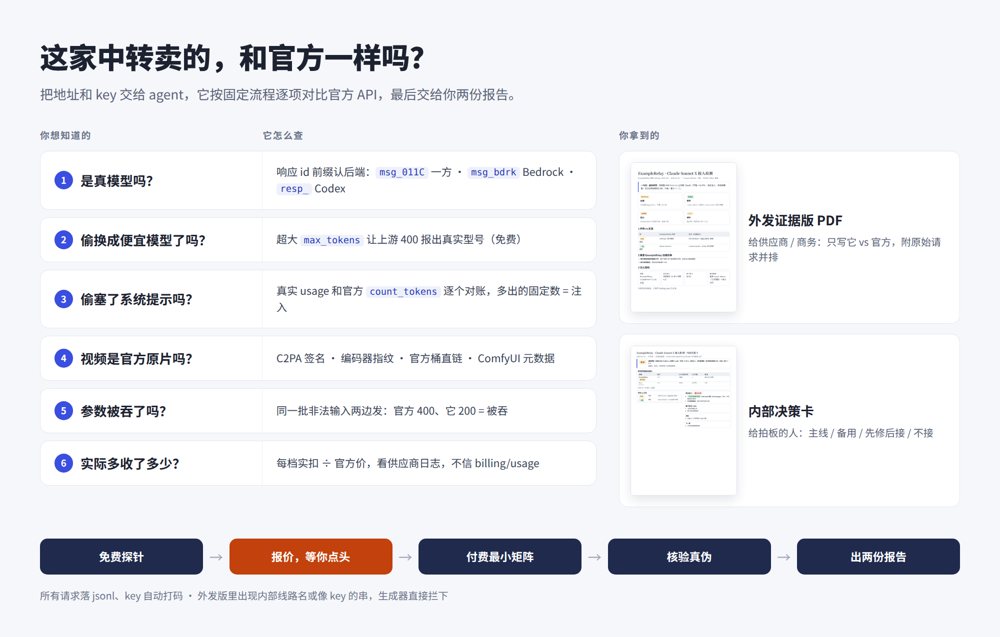
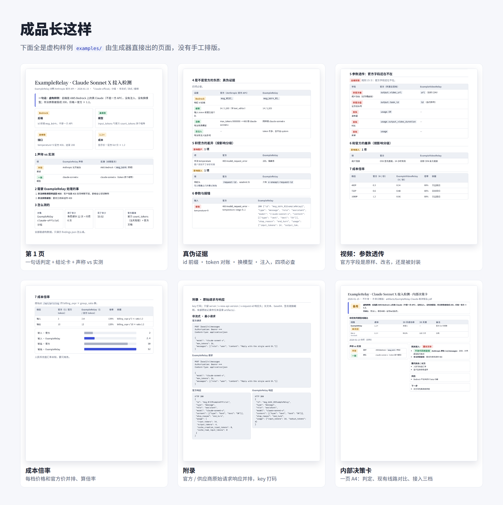

# llm-relay-audit

[English](README.md) · 给 coding agent 用的 skill：拿 AI API 中转站 / 代理（new-api、one-api、sub2api……）和官方 API 逐项对比，文本和视频线路都能测。



## 成品长这样



上图每一页都是 `build_report.py` 从虚构样例 [`examples/`](examples/) 直接生成的，完整 PDF 也在那里。

## 安装

```
/plugin marketplace add YouToco/llm-relay-audit
/plugin install llm-relay-audit@llm-relay-audit
```

也可以直接复制目录：`cp -r skills/relay-provider-audit ~/.claude/skills/`。其他 agent 让它读 [`SKILL.md`](skills/relay-provider-audit/SKILL.md) 就行。

## 用法

对 agent 说：「测一下这家中转：地址 `https://relay.example`，模型 `claude-sonnet-…`，key 在 `$K`」。

自己出一份报告：

```bash
python3 -I skills/relay-provider-audit/scripts/build_report.py examples/text/findings.json --pdf
```

| 覆盖 | 内容 |
|---|---|
| 文本基准 | Claude（一方 / Bedrock）、Grok、Gemini、Kimi、GLM、DeepSeek |
| 视频基准 | 阿里 wan3、MiniMax H3、Seedance（火山方舟 / BytePlus） |
| 中转形态 | new-api / one-api（分组、倍率、日志、参数透传）、sub2api（订阅号池） |

依赖：Python 3.10+；出 PDF 要 Chrome / Chromium；视频脚本用 `uv run --with` 现拉 Pillow / numpy / c2pa-python。

**注意：** 基准都标了 `Last verified`，用前对照官方文档核实；部分规则是偏严的默认值，可以放宽；只测你有权测试的服务。

[MIT](LICENSE)
